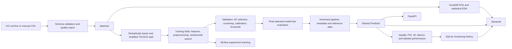

# ConvertIQ

A complete CPU-based data science portfolio project for **session-level e-commerce conversion propensity**. It combines UCI data ingestion, DuckDB business analytics, nine classifier families, validation-driven model selection, probability calibration, SHAP explanations, a seven-page Streamlit dashboard, a FastAPI service and statistical batch monitoring.

The model excludes **PageValues** because it may encode transaction-associated information. It also excludes **Revenue** from inputs. Aggregated session features do not establish a validated real-time, early-session prediction system. Associations and simulated costs are not causal effects or experimentally verified revenue gains.

## Start locally

Python 3.11+ is supported by the dependency ranges; Python 3.12 is the Docker baseline. This workspace was installed and exercised on Apple Silicon with Python 3.14.5. No GPU is required.

```bash
# macOS prerequisite for XGBoost and LightGBM
brew install libomp

python3 -m venv .venv
source .venv/bin/activate
python -m pip install -r requirements-dev.txt

make download
make eda
make train
make test
make dashboard
```

Open http://localhost:8501. In another terminal, run `make api` and open http://localhost:8000/docs for the interactive API. Run `make mlflow` for the experiment UI at http://localhost:5001. VS Code launch configurations are included.

**In the delivered workspace:** the environment, dataset, trained artifacts and reports already exist. Use `make dashboard` or `make api` directly. `requirements-lock.txt` records the exact installed environment; use it for same-platform reproduction. The ranged requirements allow compatible resolution on other supported Python versions. Exact numerical reproduction across BLAS, OS and library versions is not guaranteed.

If downloading fails:

```bash
python -m src.data.download --csv /path/to/online_shoppers_intention.csv
```

The downloader validates before writing and records the source URL and SHA-256. It never substitutes synthetic data. Synthetic fixtures exist only in tests, and controlled monitoring simulations are explicitly labeled.

## Actual results and artifacts

See [the generated results report](reports/RESULTS.md), [methodology](docs/METHODOLOGY.md), [feature availability](docs/FEATURES.md), and [operations guide](docs/OPERATIONS.md), and [verification record](reports/VERIFICATION.md). The results report is generated from real training artifacts with `python scripts/build_results.py`.

The raw UCI data contains **12,330 sessions**, **1,908 purchases**, and a **15.47%** observed conversion rate. The EDA code calculates these values from the downloaded CSV. The model-training population removes identical predictor vectors before splitting; raw business KPIs retain all original records.

Generated plots are in `reports/eda/` and `artifacts/runs/<version>/reports/`. The executed notebook is [notebooks/01_convertiq_analysis.ipynb](notebooks/01_convertiq_analysis.ipynb). Run `make notebook` after EDA and training to re-execute it.

## Architecture



## What is implemented

- Automated UCI download/manual import, strict schema, dtype and range validation, missing-value and duplicate reports, IQR outlier flags, source hashing.
- DuckDB SQL KPIs and segmentation, Wilson intervals, chi-square and Mann–Whitney tests with effect sizes and Bonferroni adjustment; generated distributions, boxplots, correlation and conversion charts.
- Train-fitted `ColumnTransformer` with numeric imputation/scaling and categorical one-hot encoding, safe feature ratios, cyclical month features, correlation/MI screening, permutation and model-based importance.
- Dummy, Logistic Regression, Decision Tree, Random Forest, SVM, Gradient Boosting, XGBoost, LightGBM and MLP. Original/engineered ablation for each learned family, stratified CV and randomized parameter search.
- Validation AP model selection, training-fold sigmoid calibration, validation precision-constrained F1 threshold, untouched-test evaluation, all requested classification/probability metrics and plots.
- Global permutation importance, approximate probability-unit SHAP summary and waterfall plots, individual SHAP explanation and a labeled non-additive background-replacement fallback.
- Executive Overview, Exploratory Data Analysis, Model Performance, Conversion Prediction, Batch Prediction, Model Monitoring and Experiment History dashboard pages.
- API endpoints: `GET /health`, `/model/info`, `/model/metrics`, `/monitoring/status`; `POST /predict`, `/predict/batch`, `/explain`.
- Input and distribution monitoring, prediction PSI, actual performance only with outcomes, historical replay and controlled synthetic drift, configurable alerts, persistent history and a documented retraining policy.
- Tests covering validation, train-only transforms, duplicate split isolation, feature screening, SQL KPIs, inference, API behavior, SHAP additivity, drift math and every dashboard page.

## Commands

| Command | Purpose |
|---|---|
| `make setup` | Create environment and install development dependencies |
| `make download` | Download and validate UCI data |
| `make eda` | Generate SQL/statistical reports and plots |
| `make train` | Run all models, ablations, screening and final evaluation |
| `make test` | Unit and integration tests; dashboard tests need trained artifacts |
| `make lint` | Static checks |
| `python -m src.monitoring.demo` | Record historical replay and synthetic drift demonstrations |
| `make notebook` | Execute analysis notebook with the active environment |
| `make dashboard` | Streamlit on local port 8501 |
| `make api` | FastAPI on local port 8000 |
| `make mlflow` | Local experiment UI on port 5001 |
| `python scripts/build_results.py` | Refresh the readable results report |

The default search uses 3 folds and 2 sampled settings per learned candidate, keeping a full run practical on a laptop. This is a deliberately modest search budget, not exhaustive optimization. `configs/extended.yaml` uses 5 folds and up to 10 parameter samples for a longer run. Do not select configurations by repeatedly checking the held-out test.

## API example

Generate a request from a real session, then call the API:

```bash
python scripts/make_example_request.py
curl -X POST http://localhost:8000/predict \
  -H 'Content-Type: application/json' \
  --data-binary @reports/example_request.json
```

A response includes `predicted_class`, `conversion_probability`, `propensity_segment`, `model_version`, and `decision_threshold`. `/predict/batch` accepts `{"sessions": [session, ...]}` with up to 10,000 rows. API inputs deliberately reject `Revenue`, `PageValues`, extra keys, nonfinite values, malformed categories and out-of-range fields. CSV batch workflows allow target/leakage columns as metadata while selecting only the approved features for inference.

## Deployment

```bash
docker compose build
docker compose --profile training run --rm train
docker compose up api dashboard
```

Download and EDA commands should run first. Train inside the Docker environment when serving in Docker to match serialization dependencies. The training profile mounts data, reports and artifacts; API and dashboard consume the same version pointer. The image runs as a non-root user and Compose publishes to localhost. Docker execution requires Docker Desktop; see the verification report for what was actually exercised on this machine.

This is production-oriented portfolio software, not an authenticated public multi-tenant service. For deployment outside a trusted local environment, add an authenticated TLS gateway, request-rate limits, artifact access controls, outcome joining, a labeled rolling evaluation store and a workload-specific performance budget. Monitoring history is local SQLite and cannot replace a fleet-wide observability system.

## Repository layout

```text
configs/                 seeds, split/search parameters and alert thresholds
src/data/                download, schema, SQL analytics and EDA
src/features/            deterministic features and train-fitted selection
src/models/              registry, training, schemas and shared inference
src/evaluation/          probability metrics, thresholds and charts
src/explainability/      SHAP and permutation explanations
src/monitoring/          drift, quality, history and simulations
dashboard/               seven-page Streamlit application
notebooks/               executable data science narrative
data/raw/                immutable downloaded source CSV
data/processed/          reproducible train/validation/test CSVs
artifacts/runs/          versioned models, metadata, reference data and reports
reports/                 EDA, results and verification evidence
tests/                   synthetic unit fixtures and actual-artifact UI checks
scripts/                 notebook execution and report generation
docs/                    methodology, feature availability and operations
app.py / api.py           dashboard and API entry points
```

Large artifacts, data, local tracking databases and virtual environments are excluded from Git. Every needed derived file can be regenerated with the commands above. Include only public, reviewed outputs when publishing this portfolio.

## Dataset attribution

Sakar, C. & Kastro, Y. (2018). *Online Shoppers Purchasing Intention Dataset*. UCI Machine Learning Repository. DOI: [10.24432/C5F88Q](https://doi.org/10.24432/C5F88Q). [Dataset page](https://archive.ics.uci.edu/dataset/468/online+shoppers+purchasing+intention+dataset). Licensed under **CC BY 4.0**. Data are historical shopping sessions, not udaan customer data; applicability to a B2B platform needs separate validation.
