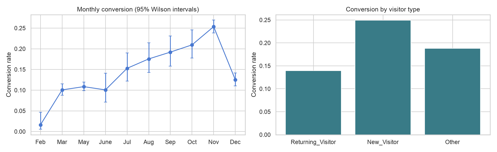
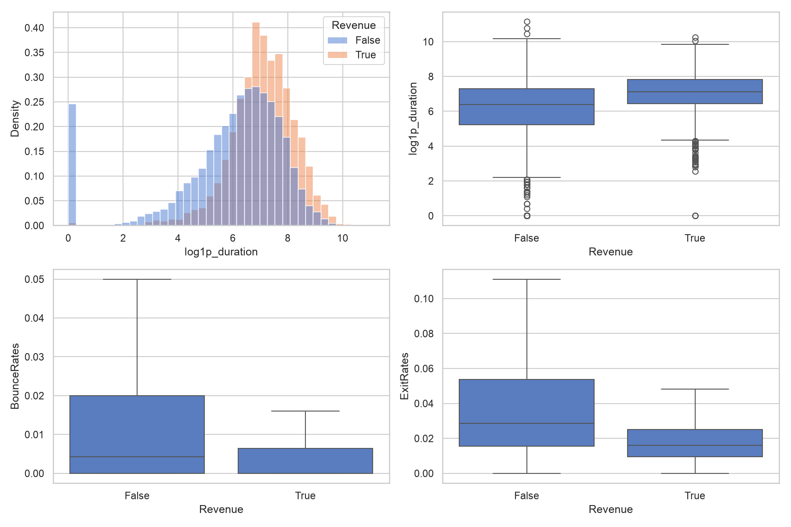

# ConvertIQ — actual execution results

Generated from model version **20261126T124223Z-b3e5f2**. Dataset SHA-256: `b3055ee355f59134d851d32641183cb4a8b45def7124d2f50442a042f358e0d9`.

## Observed business patterns

- Observed conversion: 1,908/12,330 (15.47%).
- 95% Wilson interval: 14.85%–16.12%.
- Among traffic codes with at least 100 sessions, code 8.0 has the highest observed rate (27.70%, n=343). Codes have no channel-name mapping.
- Returning_Visitor: 13.93% observed conversion.
- New_Visitor: 24.91% observed conversion.

These are historical associations; traffic codes are not named marketing channels. Interval and test details are in `reports/eda/`.

## Reproducible partition

12,330 raw rows; 125 identical predictor rows removed for modeling. Train **8,543**, validation **1,831**, test **1,831**. Raw EDA retains all records.

## Validation comparison

At threshold 0.5; selection prioritizes AP, not accuracy. Batch latency is amortized milliseconds per row, not an individual-request tail-latency benchmark.

| model | cv_average_precision | average_precision | roc_auc | precision | recall | f1 | training_seconds | batch_ms_per_row |
| --- | --- | --- | --- | --- | --- | --- | --- | --- |
| lightgbm__original | 0.3756 | 0.3506 | 0.7535 | 0.2821 | 0.6678 | 0.3967 | 2.5514 | 0.0089 |
| random_forest__original | 0.3802 | 0.3409 | 0.7578 | 0.2755 | 0.7273 | 0.3996 | 2.2572 | 0.0164 |
| xgboost__engineered | 0.3777 | 0.3375 | 0.7515 | 0.2769 | 0.6923 | 0.3956 | 1.0517 | 0.0046 |
| random_forest__engineered | 0.3809 | 0.3363 | 0.7631 | 0.2932 | 0.6643 | 0.4069 | 2.7432 | 0.0176 |
| lightgbm__engineered | 0.3771 | 0.3310 | 0.7617 | 0.4043 | 0.0664 | 0.1141 | 2.9671 | 0.0103 |
| gradient_boosting__original | 0.3703 | 0.3249 | 0.7474 | 0.4524 | 0.0664 | 0.1159 | 8.3317 | 0.0042 |
| xgboost__original | 0.3783 | 0.3233 | 0.7508 | 0.2762 | 0.6818 | 0.3931 | 0.8571 | 0.0035 |
| gradient_boosting__engineered | 0.3681 | 0.3184 | 0.7505 | 0.4091 | 0.0315 | 0.0584 | 13.1071 | 0.0054 |
| decision_tree__original | 0.3096 | 0.3110 | 0.7162 | 0.2643 | 0.6643 | 0.3781 | 0.3198 | 0.0029 |
| mlp__engineered | 0.3443 | 0.3043 | 0.7262 | 0.4118 | 0.1713 | 0.2420 | 1.3373 | 0.0048 |
| svm__engineered | 0.3527 | 0.3026 | 0.7411 | 0.3333 | 0.0245 | 0.0456 | 42.5611 | 0.3841 |
| logistic_regression__engineered | 0.3336 | 0.2937 | 0.7287 | 0.2587 | 0.7028 | 0.3782 | 0.3527 | 0.0042 |
| logistic_regression__original | 0.3346 | 0.2929 | 0.7261 | 0.2549 | 0.6888 | 0.3720 | 0.2850 | 0.0029 |
| svm__original | 0.3417 | 0.2901 | 0.7318 | 0.3158 | 0.0210 | 0.0393 | 42.6220 | 0.3211 |
| decision_tree__engineered | 0.3067 | 0.2814 | 0.7072 | 0.2662 | 0.6329 | 0.3747 | 0.4824 | 0.0044 |
| mlp__original | 0.3472 | 0.2742 | 0.6960 | 0.3147 | 0.1573 | 0.2098 | 1.3495 | 0.0033 |
| dummy__original | 0.1564 | 0.1562 | 0.5000 | 0.0000 | 0.0000 | 0.0000 | 0.2912 | 0.0028 |

## Feature-engineering ablation

| family | Original AP | Engineered AP | AP change |
| --- | --- | --- | --- |
| decision_tree | 0.3110 | 0.2814 | -0.0296 |
| gradient_boosting | 0.3249 | 0.3184 | -0.0065 |
| lightgbm | 0.3506 | 0.3310 | -0.0195 |
| logistic_regression | 0.2929 | 0.2937 | 0.0008 |
| mlp | 0.2742 | 0.3043 | 0.0301 |
| random_forest | 0.3409 | 0.3363 | -0.0046 |
| svm | 0.2901 | 0.3026 | 0.0125 |
| xgboost | 0.3233 | 0.3375 | 0.0142 |

Additional train-only correlation/MI screening retained 58 encoded columns. Validation AP: **0.3458**; selected: **False**. This candidate is separate from the original/engineered table above.

## Selected pipeline and final evaluation

Selected: **lightgbm__original**. Sigmoid calibration selected: **True**. Decision threshold: **0.24**, selected using validation F1 subject to minimum precision 0.30. No post-selection refit used validation or test rows.

| Metric | Held-out test |
| --- | --- |
| accuracy | 0.7477 |
| precision | 0.3400 |
| recall | 0.6538 |
| f1 | 0.4474 |
| balanced_accuracy | 0.7094 |
| log_loss | 0.3610 |
| brier_score | 0.1130 |
| roc_auc | 0.7886 |
| average_precision | 0.3760 |

Confusion matrix `[[TN, FP], [FN, TP]]`: `[[1182, 363], [99, 187]]`.

The test split supports final reporting only. Stored versions from development reruns are not independent replications. The historical sample, modest search budget and single held-out split limit generalization; no early-session or causal claim is justified.

## Global model behavior

Largest raw-feature permutation importance values on the fixed validation subset (mean decrease in AP):

| feature | importance | std |
| --- | --- | --- |
| ExitRates | 0.0585 | 0.0052 |
| ProductRelated_Duration | 0.0571 | 0.0381 |
| VisitorType | 0.0254 | 0.0017 |
| ProductRelated | 0.0224 | 0.0096 |
| Month | 0.0210 | 0.0093 |
| OperatingSystems | 0.0170 | 0.0021 |
| Administrative | 0.0134 | 0.0120 |
| TrafficType | 0.0121 | 0.0065 |

Importance is conditional on this fitted model and correlations between inputs. It is not an intervention effect. SHAP summary/waterfall available: **True**.

## Visual evidence

Final evaluation and explanation PNGs are in `artifacts/runs/20261126T124223Z-b3e5f2/reports/`. Open the dashboard's Model Performance page for interactive views.
